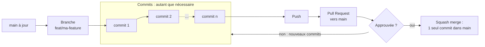
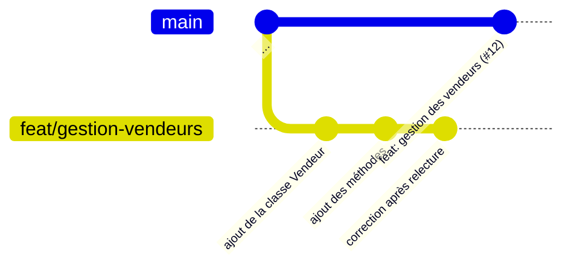
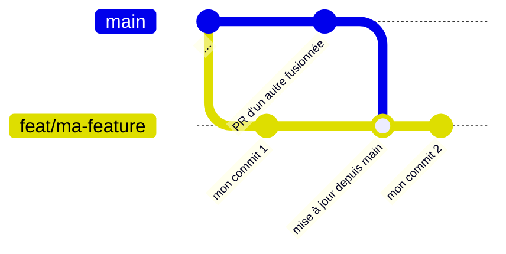

# Contribuer au projet Enseigne

> **Règle d'or :** on ne pousse jamais directement sur `main`. Chaque modification passe par une branche personnelle, puis par une Pull Request (PR) validée par un responsable GitHub (voir le tableau « Organisation des membres » du [README](README.md)).

## Le circuit en un coup d'œil



## Une seule fois : préparer son poste

1. Créez un compte sur [GitHub](https://github.com) et donnez votre pseudo à un responsable GitHub.
2. Acceptez l'invitation à l'organisation **M2-MMAA** (reçue par mail, ou sur https://github.com/orgs/M2-MMAA/invitation). Sans cette étape, vous ne pourrez pas pousser votre travail.
3. Configurez Git (une seule fois par ordinateur) :
   ```console
   git config --global user.name "Prénom Nom"
   git config --global user.email "adresse-utilisee-sur-github@exemple.fr"
   git config --global pull.rebase false
   ```
4. Clonez le dépôt de l'organisation et installez le projet (voir [Installation](README.md#installation-à-partir-dun-terminal)). Pas besoin de fork : on travaille tous directement sur le dépôt `M2-MMAA/Enseigne`.

## Nommer sa branche et sa Pull Request

On suit la convention [Conventional Commits](https://www.conventionalcommits.org/) : un **type**, deux-points, puis une description courte.

| Type | Quand l'utiliser | Exemple de titre de PR |
|------|------------------|------------------------|
| `feat` | Nouvelle fonctionnalité | `feat: ajout de la classe Vendeur` |
| `fix` | Correction d'un bug | `fix: calcul du total d'une vente` |
| `docs` | Documentation, diagrammes UML, README | `docs: diagramme de séquence d'une vente` |
| `refactor` | Réorganisation du code sans changer son comportement | `refactor: découpage de la classe Magasin` |
| `test` | Ajout ou modification de tests | `test: tests de la classe Client` |
| `chore` | Configuration et maintenance du dépôt | `chore: mise à jour du .gitignore` |

- **Titre de la PR** : `type: description`. C'est le plus important, car avec le squash merge ce titre devient le message du commit dans `main`.
- **Nom de la branche** : `type/description-courte`, en minuscules, avec des tirets (exemple : `feat/gestion-vendeurs`).
- **Commits dans votre branche** : faites-en autant que nécessaire, avec des messages clairs (le format `type: description` est conseillé, pas obligatoire). Au moment de la fusion, ils sont regroupés en **un seul commit** dans `main` (squash), mais ils restent consultables dans l'onglet **Commits** de la PR.



## À chaque nouvelle tâche

1. Partez de `main` à jour :
   ```console
   git switch main
   git pull
   ```
2. Créez votre branche de travail (voir la convention ci-dessus) :
   ```console
   git switch -c feat/gestion-vendeurs
   ```
3. Codez, puis enregistrez votre travail par **commits**. Un commit correspond à une étape cohérente (« classe créée », « méthodes ajoutées », « bug corrigé »…). Il n'y a pas de limite : commitez aussi souvent que vous le voulez.
   1. Regardez ce qui a changé :
      ```console
      git status
      ```
   2. Choisissez ce qui part dans le commit :
      - **tous** les fichiers créés ou modifiés (à lancer depuis la racine du projet, `.` désignant le dossier courant et tout ce qu'il contient) :
        ```console
        git add .
        ```
      - **seulement certains** fichiers :
        ```console
        git add src/enseigne/vendeur.py doc/class.mmd
        ```
   3. Vérifiez avec `git status` : les fichiers listés sous « Changes to be committed » partiront dans le commit. Un fichier ajouté par erreur se retire avec `git restore --staged nom_du_fichier` (vos modifications ne sont pas perdues).
   4. Enregistrez le commit :
      ```console
      git commit -m "feat: ajout de la classe Vendeur"
      ```

   Recommencez ces quatre étapes à chaque avancée.
4. Envoyez vos commits sur GitHub. La première fois :
   ```console
   git push -u origin feat/gestion-vendeurs
   ```
   Ensuite, `git push` suffit. Vous pouvez pousser à tout moment et autant de fois que vous voulez : c'est aussi une sauvegarde de votre travail.
5. Ouvrez la Pull Request :
   - Sur la page du dépôt, cliquez sur **Compare & pull request**.
   - Vérifiez que la branche cible (*base*) est bien `main`.
   - Donnez un titre au format `type: description` et décrivez ce que vous avez fait. Si votre branche ne contient qu'un seul commit, GitHub reprend son message comme titre : vérifiez qu'il respecte le format.
   - Les responsables GitHub sont ajoutés automatiquement comme relecteurs.
   - Pas encore terminé ? Choisissez **Create draft pull request** dans le menu du bouton : la PR est visible mais marquée « brouillon ». Cliquez sur **Ready for review** quand elle est prête.
6. Si des modifications sont demandées : corrigez, puis `git add`, `git commit` et `git push`. La PR se met à jour toute seule. Cliquez sur **Resolve conversation** pour chaque commentaire traité.
7. Une fois la PR fusionnée, nettoyez votre poste :
   ```console
   git switch main
   git pull
   git branch -D feat/gestion-vendeurs
   ```
   > `-D` (en majuscule) est nécessaire : avec le squash merge, Git ne reconnaît pas la branche comme fusionnée. N'utilisez cette commande qu'une fois la PR fusionnée.

## Mettre sa branche à jour quand `main` a avancé

**Quand ça arrive :** vous avez créé votre branche depuis `main`, puis la PR d'un autre membre a été fusionnée dans `main` avant la vôtre. Votre branche ne contient pas ce nouveau travail : elle est « en retard » sur `main`.



**Faut-il la mettre à jour ?**

- **Oui, obligatoirement**, si GitHub affiche « This branch has conflicts that must be resolved » : la PR ne peut pas être fusionnée tant que les conflits ne sont pas résolus.
- **Oui**, si vous avez besoin du code qui vient d'arriver dans `main` (par exemple une classe dont dépend la vôtre).
- **Sinon, c'est facultatif** : GitHub affiche « This branch is out-of-date with the base branch », mais la fusion reste possible.

> Avant toute mise à jour en ligne de commande, commitez votre travail en cours : `git status` doit indiquer « nothing to commit, working tree clean ».

### Cas 1 : votre PR n'est pas encore ouverte

```console
git switch feat/ma-feature
git fetch origin
git merge origin/main --no-edit
```

Si votre branche est déjà sur GitHub, terminez par `git push`. En cas de conflit, voir le cas 3.

### Cas 2 : votre PR est ouverte, sans conflit

1. Dans la PR, cliquez sur **Update branch** (au-dessus du bouton de fusion). GitHub ajoute un commit de mise à jour sur votre branche, directement sur GitHub.
2. En local, récupérez-le avant de continuer à travailler :
   ```console
   git pull --no-edit
   ```
   Sans cette étape, votre prochain `git push` sera refusé.

### Cas 3 : votre PR est ouverte, avec des conflits

Un conflit apparaît quand vous et l'autre PR avez modifié les mêmes lignes d'un fichier : Git ne sait pas quelle version garder.

- **Conflit simple** : cliquez sur **Resolve conflicts** dans la PR, corrigez dans l'éditeur de GitHub, puis **Mark as resolved** et **Commit merge**. En local, faites ensuite `git pull --no-edit`.
- **Sinon** (ou si le bouton est grisé), en local :
  ```console
  git switch feat/ma-feature
  git fetch origin
  git merge origin/main
  ```
  Git liste les fichiers en conflit. Dans chacun, les deux versions sont encadrées ainsi :
  ```text
  <<<<<<< HEAD
  votre version
  =======
  la version de main
  >>>>>>> origin/main
  ```
  Gardez la bonne version (ou combinez les deux) et supprimez les trois lignes de marqueurs. VS Code propose des boutons *Accept Current Change*, *Accept Incoming Change* et *Accept Both Changes*. Puis :
  ```console
  git add nom_du_fichier
  git commit --no-edit
  git push
  ```
  En cas de doute, `git merge --abort` annule tout et revient à l'état d'avant. Demandez alors de l'aide à un responsable GitHub.

## Livraisons

Les livraisons sont des tags posés sur `main` par les responsables GitHub à chaque date limite (voir la section « Livraisons » du [README](README.md#livraisons)). Une PR fusionnée après la date limite part simplement dans la livraison suivante : ouvrez vos PR suffisamment tôt pour laisser le temps à la relecture.

## Problèmes fréquents

- **`git push` demande un mot de passe, ou « Authentication failed »** : GitHub n'accepte plus votre mot de passe en ligne de commande. Trois solutions, de la plus simple à la plus manuelle :
  1. **Windows** : au premier `git push`, Git for Windows ouvre normalement une fenêtre de connexion. Choisissez *Sign in with your browser* et autorisez l'accès. C'est mémorisé ensuite.
  2. **macOS / Linux**, ou si aucune fenêtre ne s'ouvre : installez [GitHub CLI](https://cli.github.com/), lancez `gh auth login`, puis choisissez *GitHub.com*, *HTTPS*, acceptez d'authentifier Git et choisissez *Login with a web browser*.
  3. **Jeton d'accès (token)**, sans rien installer : sur GitHub, allez dans *Settings → Developer settings → Personal access tokens → Tokens (classic) → Generate new token (classic)*. Cochez `repo`, choisissez une date d'expiration (la fin du semestre, par exemple), puis copiez le jeton : il n'est affiché qu'une seule fois. Au prochain `git push`, donnez votre pseudo GitHub comme identifiant et collez le jeton à la place du mot de passe. Prenez bien un token *classic* : les tokens *fine-grained* doivent d'abord être approuvés par un administrateur de l'organisation.
- **`Permission denied` ou erreur `403`** : vous n'avez pas encore accepté l'invitation à l'organisation, ou vous n'avez pas encore les droits. Prévenez un responsable GitHub.
- **Push refusé sur `main` (« protected branch »)** : vous avez commité directement sur `main`. Vos changements ne sont pas perdus :
  ```console
  git switch -c feat/ma-feature        # emmène vos commits sur une nouvelle branche
  git push -u origin feat/ma-feature   # puis ouvrez la Pull Request
  git branch -f main origin/main       # remet votre main local d'aplomb
  ```
- **Push refusé sur votre branche (« rejected », « fetch first »)** : la branche sur GitHub contient des commits que vous n'avez pas (par exemple après un clic sur **Update branch**). Faites `git pull --no-edit`, puis `git push`.
- **Un écran rempli de `~` s'ouvre après `git pull`, `git merge` ou `git commit`** : c'est l'éditeur Vim, qui vous demande de confirmer un message de commit. Tapez `:wq` puis Entrée pour valider et quitter. L'option `--no-edit` évite cet écran pour les fusions.
